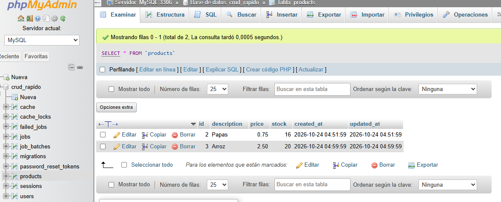
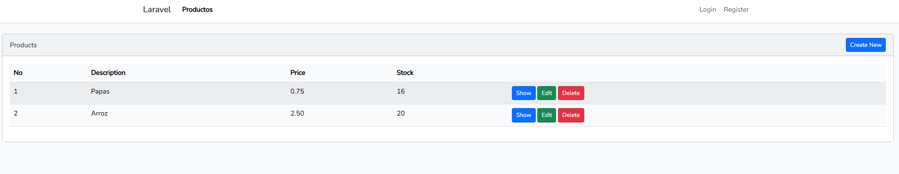
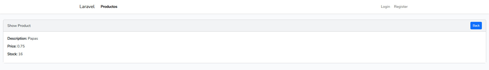
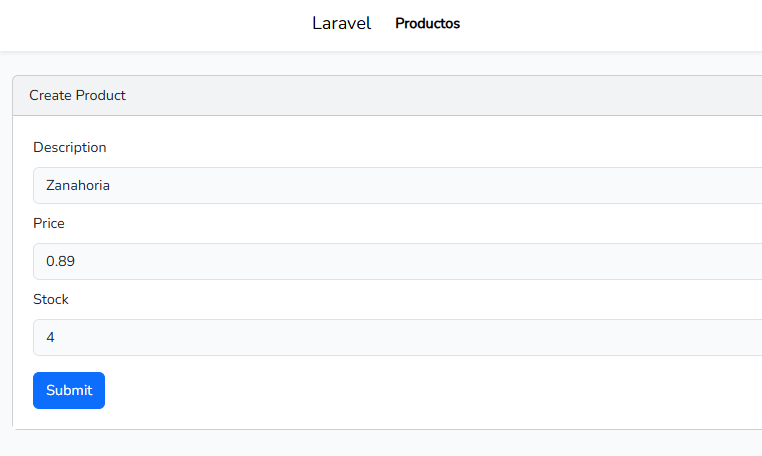
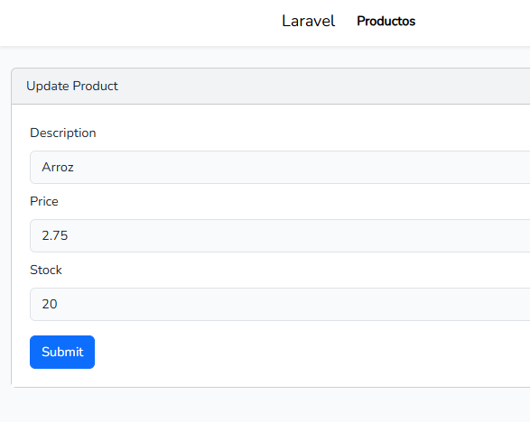
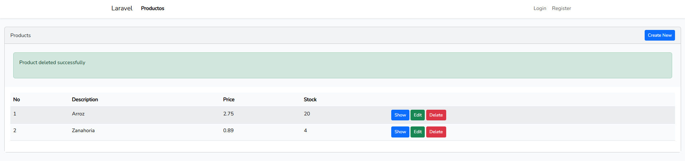
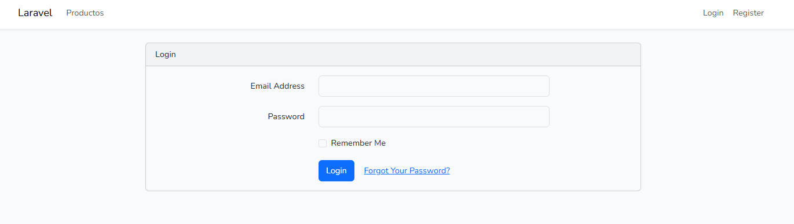

# Laboratorio #2: CRUD rápido en Laravel

**Fecha:** 16/10/2026

## Contenido del Repositorio

Este repositorio contiene el **Laboratorio #2** de Desarrollo Web: un **CRUD rápido** de productos construido con **Laravel**. Se crea el modelo `Product` con su migración (descripción, precio y stock), se genera automáticamente el CRUD completo (controlador, validaciones y vistas) con el paquete `ibex/crud-generator` y se registran las rutas con `Route::resource`. El proyecto usa el patrón **MVC**, una base de datos **MySQL** administrada desde WampServer y vistas en **Blade con Bootstrap**. Además incluye registro e inicio de sesión de usuarios con `laravel/ui`.

## Tecnologías Utilizadas

- **Lenguaje / Framework:** PHP 8.3.28, Laravel 13.38.0, Blade, Bootstrap 5, Sass y Vite
- **Paquetes de Laravel:** `ibex/crud-generator` 2.1.9 (generación del CRUD) y `laravel/ui` (login y registro)
- **Base de datos:** MySQL (motor InnoDB)
- **Herramientas:** WampServer, Composer, Node.js y npm, Git y GitHub, Visual Studio Code y PowerShell

## Capturas de Pantalla y Problemas

### Interfaz Principal



- **Migración de la tabla `products`:** se creó el modelo y su migración con `php artisan make:model Product -m`. La tabla tiene las columnas `id`, `description` (texto), `price` (decimal de 8 dígitos y 2 decimales), `stock` (entero) y `timestamps`. Se ejecutó con `php artisan migrate`.

  

- **Read (listar y ver productos):** la ruta `GET /products` muestra todos los productos en una tabla y `GET /products/{id}` muestra el detalle de uno. Está implementado en los métodos `index` y `show` de `ProductController`.

  

- **Create (crear un producto):** el formulario de `GET /products/create` envía los datos por `POST /products`. El método `store` valida los campos y guarda el registro. El modelo define `$fillable` con `description`, `price` y `stock` para permitir la asignación masiva de forma segura.

  

- **Update (editar un producto):** el formulario de `GET /products/{id}/edit` envía los cambios por `PUT /products/{id}` y el método `update` los guarda.

  

- **Delete (eliminar un producto):** el botón eliminar envía una petición `DELETE /products/{id}` que ejecuta el método `destroy` y borra el registro.

  

- **Registro e inicio de sesión:** con `laravel/ui` se generaron las pantallas de `/register` y `/login`. El cierre de sesión redirige a `/login` y la barra de navegación incluye un enlace a **Productos**.

  

## Estructura de Carpetas o Directorios

```plaintext
crud_rapido/
│
├── app/
│   ├── Http/
│   │   ├── Controllers/
│   │   │   ├── Auth/                 # Login y registro (laravel/ui)
│   │   │   ├── HomeController.php    # Página de inicio tras iniciar sesión
│   │   │   └── ProductController.php # Controlador del CRUD de productos
│   │   └── Requests/                 # Validación de los formularios
│   ├── Models/
│   │   └── Product.php               # Modelo Product con $fillable
│   └── Providers/
│       └── AppServiceProvider.php    # Schema::defaultStringLength(191)
├── config/
│   ├── crud.php                      # Configuración del generador de CRUD
│   └── database.php                  # Conexión MySQL con motor InnoDB
├── database/
│   └── migrations/                   # Migraciones (users, cache, jobs, products)
├── resources/
│   ├── js/app.js                     # JavaScript de Bootstrap
│   ├── sass/app.scss                 # Estilos de Bootstrap
│   └── views/
│       ├── layouts/app.blade.php     # Plantilla principal con la barra de navegación
│       ├── auth/                     # Vistas de login y registro
│       └── product/                  # Vistas del CRUD (listar, crear, editar y ver)
├── routes/
│   └── web.php                       # Rutas, incluye Route::resource('products')
├── docs/                             # Capturas de pantalla del README
├── .env.example                      # Plantilla de variables de entorno
├── composer.json                     # Dependencias de PHP
├── package.json                      # Dependencias de Node
├── vite.config.js                    # Configuración de Vite
├── capturas                          # Contiene las imagenes de prueba del laboratorio
└── README.md                         # Documentación del proyecto
```

## Instrucciones de Ejecución / Uso

1. **Clonar el repositorio:**
   ```powershell
   cd C:\wamp64\www
   git clone https://github.com/TU_USUARIO/TU_REPOSITORIO.git crud_rapido
   cd crud_rapido
   ```

2. **Configurar el entorno local:**
   - Abre **WampServer** y espera a que el icono esté **verde** (MySQL encendido).
   - Instala las dependencias y crea el archivo de entorno:
     ```powershell
     composer install
     npm install
     copy .env.example .env
     php artisan key:generate
     ```
   - Edita el archivo `.env` con los datos de la base de datos:
     ```env
     DB_CONNECTION=mysql
     DB_HOST=127.0.0.1
     DB_PORT=3306
     DB_DATABASE=crud_rapido
     DB_USERNAME=root
     DB_PASSWORD=
     ```
   - Limpia la caché y crea las tablas (si pregunta si crea la base de datos `crud_rapido`, responde `yes`):
     ```powershell
     php artisan config:clear
     php artisan migrate
     ```

3. **Ejecutar el comando de arranque:**
   ```powershell
   npm run build
   composer run dev
   ```
   Abre en el navegador:
   - Productos (CRUD): <http://127.0.0.1:8000/products>
   - Registro: <http://127.0.0.1:8000/register>
   - Login: <http://127.0.0.1:8000/login>

**Comandos usados durante el laboratorio:**

```powershell
php artisan make:model Product -m          # modelo y migración
php artisan migrate                        # crear las tablas
composer require ibex/crud-generator --dev # instalar el generador de CRUD
php artisan vendor:publish --tag=crud      # publicar la configuración del generador
php artisan make:crud products             # generar controlador, vistas y validaciones
composer dump-autoload                     # refrescar el autoload de clases
php artisan route:list --path=products     # verificar las rutas del CRUD
```

## Autor y Contexto

- **Nombre:** ENicole Pinto
- **Institución:** Universidad Tecnológica de Panamá (UTP)
- **Curso:** Desarrollo Web
- **Instructora:** Ing. Irina Fong
- **Fecha de Realización:** 23/10/2026

## Referencias

- Fong, I. *Acercamiento a un CRUD rápido en Laravel: Guía del Laboratorio #2.* Universidad Tecnológica de Panamá, 2026.
- [Video de apoyo](https://www.youtube.com/watch?v=j5baJsM_Adc)
- [Documentación oficial de Laravel](https://laravel.com/docs)
- [ibex/crud-generator en Packagist](https://packagist.org/packages/ibex/crud-generator)
- [laravel/ui en GitHub](https://github.com/laravel/ui)
- [Composer: documentación](https://getcomposer.org/doc/)
